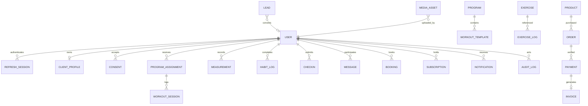

# Syre Banks Fitness — architecture

## Architecture summary

A modular monolith: a React browser application talks to one versioned FastAPI API. PostgreSQL is the source of truth; Redis supports rate limits and Celery jobs. S3-compatible storage owns binary assets. Domain services enforce ownership and permissions before repository operations. No microservices are required.

## Technology decisions

- React 19, strict TypeScript, Vite, React Router, TanStack Query, React Hook Form, Zod, Tailwind CSS, Lucide and Recharts.
- Python 3.12, FastAPI, Pydantic 2, SQLAlchemy 2, Alembic and PostgreSQL. SQLite is permitted only as an explicit local/test fallback, never as the production database.
- Redis and Celery for substantial asynchronous jobs. BackgroundTasks only for lightweight work.
- Docker Compose provides web, API, database, cache, worker and MinIO. Environment variables configure external services.
- English translation resources, UTC timestamps, IANA display timezones and integer minor currency units.

## Repository tree

```text
apps/
  web/  # app, components, features, layouts, pages, services, locales
  api/  # app/core, app/modules, app/providers, migrations, tests
packages/
  shared-types/
  ui/
  config/
infrastructure/
scripts/
docs/
.github/workflows/
docker-compose.yml
.env.example
```

## Database entity map



UUID keys, UTC creation/update timestamps, foreign keys, ownership indexes and uniqueness constraints apply to durable records. Product prices, legal agreements, check-in questions and assigned program content require historical snapshots.

## Security model

Access tokens are short-lived JWTs. Refresh tokens are randomly generated, hashed at rest and rotated; reuse revokes the session family. Passwords use Argon2. Registration never accepts a privileged role. SUPER_ADMIN and ADMIN have business access; COACH access is restricted to assigned clients; CLIENT access is restricted to their own data; LEAD has application/account access. Authorization runs on the API, not just React routes.

Refresh credentials use HttpOnly cookies with production Secure settings and strict Origin checks. CORS uses an allowlist. Request IDs and structured errors avoid exposing tracebacks. Rate limits protect authentication and public forms. Private client uploads use validated media and private storage; public publication requires separate consent. Audit entries omit passwords, tokens and sensitive form bodies.

## API module map

`/api/v1/auth`, `/users`, `/clients`, `/leads`, `/programs`, `/exercises`, `/workouts`, `/nutrition`, `/habits`, `/progress`, `/checkins`, `/bookings`, `/messages`, `/notifications`, `/products`, `/orders`, `/payments`, `/subscriptions`, `/invoices`, `/feedback`, `/blog`, `/media`, `/integrations`, `/analytics`, `/audit`, `/admin`.

Readiness checks the actual database; health reports process availability. Every implemented module documents request/response schemas in OpenAPI. Planned endpoints must not be advertised as working.

## Frontend route map

- Public: `/`, `/about`, `/programs`, `/services`, `/transformations`, `/exercises`, `/blog`, `/apply`, `/pricing`, `/faq`, `/contact`, `/legal/:policy`.
- Account: `/login`, `/register`, `/forgot-password`, `/reset-password`, `/verify-email`.
- Client: `/app`, `/app/workouts`, `/app/programs`, `/app/progress`, `/app/nutrition`, `/app/habits`, `/app/checkins`, `/app/messages`, `/app/bookings`, `/app/billing`, `/app/onboarding`.
- Coach/admin: `/admin`, `/admin/clients`, `/admin/clients/:id`, `/admin/leads`, `/admin/programs`, `/admin/exercises`, `/admin/checkins`, `/admin/messages`, `/admin/calendar`, `/admin/payments`, `/admin/content`, `/admin/settings`, `/admin/audit`.

Protected layouts use API identity and return friendly loading, empty, error and permission states. Demo data is explicitly labeled and cannot masquerade as production records.

## Integration strategy

PaymentProvider, StorageProvider, EmailProvider, CalendarProvider and VideoMeetingProvider are interfaces. Flutterwave is the first payment adapter. Server-side verification checks transaction reference, amount, currency and order ownership before an idempotent activation/invoice transaction. No front-end success redirect unlocks access. Unconfigured integrations expose a clear unavailable state. OAuth credentials remain encrypted on the server. Celery jobs handle retries and email/media/report work.

## MVP implementation sequence

0. Architecture and security boundaries (this document).
1. Monorepo, applications, configuration, database, migrations, Redis, Docker, logging, errors, CI. Run lint, typecheck, backend/frontend tests and both apps.
2. Authentication, RBAC, rotating sessions, verification/reset, ownership tests.
3. Responsive marketing website and editable public content foundations.
4. Eight-step application, lead persistence, CRM stages and follow-up.
5. Client profiles, goals, assessment and versioned consent.
6. Exercise catalog, reusable programs, snapshot assignments and workout/progress logs.
7. Habits, check-ins, messages, notifications and private form review.
8. Configurable products, verified payments, subscriptions and invoices.
9. Availability, collision-safe UTC bookings and calendar/meeting adapters.
10. Analytics, audit, CMS, feedback and integrations.
11. Optional advanced modules behind feature flags.

At each gate run relevant tests and update IMPLEMENTATION_STATUS.md. Security, payment and ownership gates require integration tests.

## Risks and assumptions

- No coach photographs, testimonials or transformation consent were supplied. Any initial imagery is illustrative; no fabricated coach identity or client results.
- Flutterwave merchant credentials, OAuth apps, mail delivery and hosted storage are external configuration requirements. Financial activation is blocked until genuine server verification is configured.
- Legal copy remains a clearly marked review draft. Health screening flags human review and does not diagnose or prescribe.
- Local development data is synthetic and isolated. Default production passwords are prohibited; seed credentials come from environment variables.
- PostgreSQL/Redis/S3 are production dependencies; local SQLite is an explicit convenience and does not establish PostgreSQL deployment verification.
- Production readiness requires a deployed acceptance test, jurisdiction-specific legal review, backup/restore validation and provider sandbox verification. A rendered page alone is insufficient.
